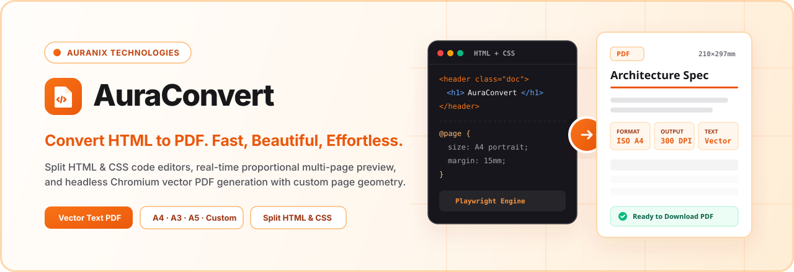
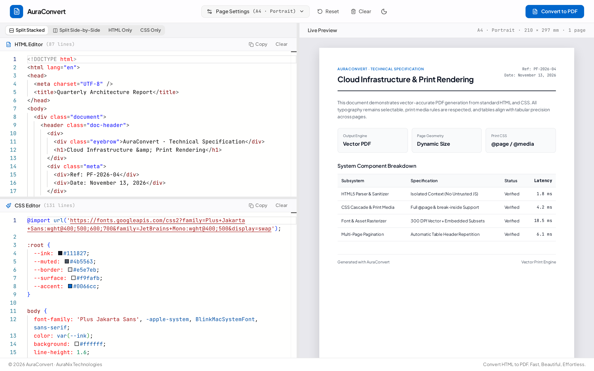
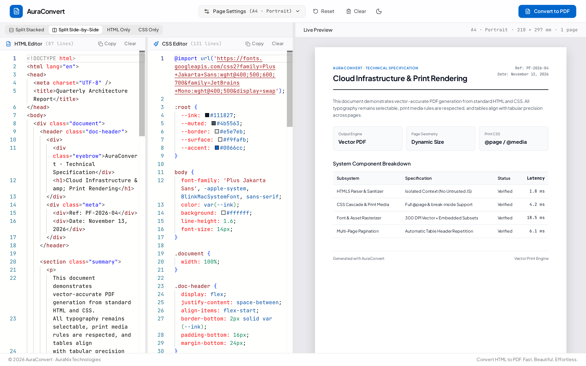
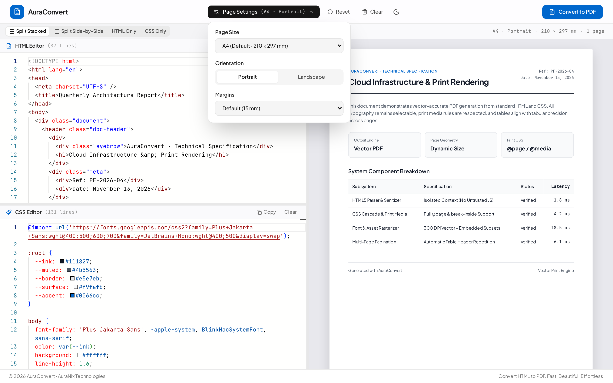
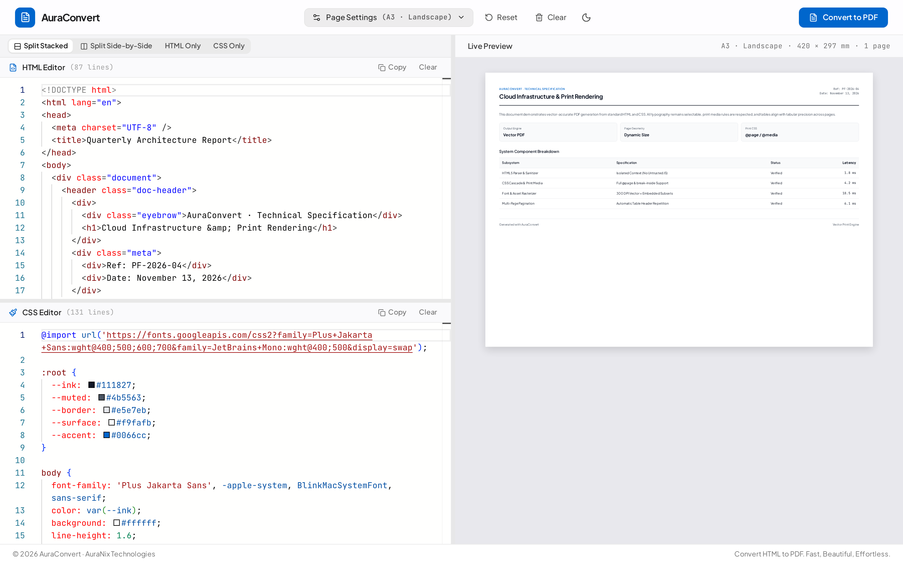
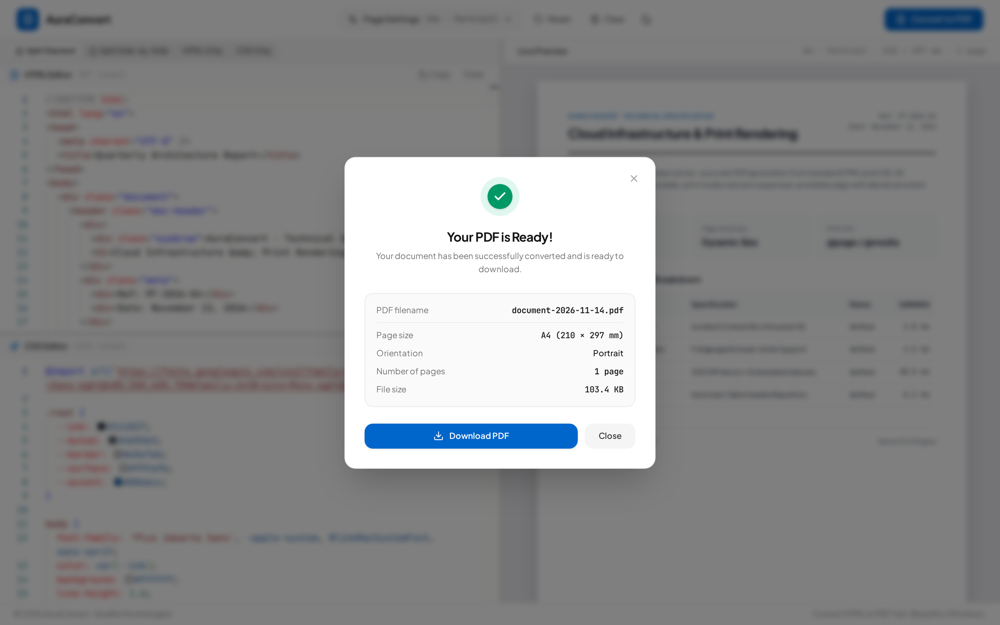
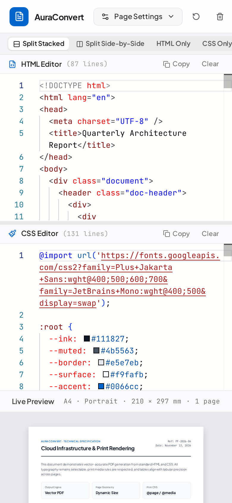

<div align="center">



<br />

# AuraConvert

### **Convert HTML to PDF. Fast, Beautiful, Effortless.**

An enterprise-grade, web-based **HTML & CSS to PDF Converter** built with **React 19**, **TypeScript**, **Tailwind CSS v4**, **Monaco Editor**, **Express**, and **Playwright Chromium**. Engineered by **AuraNix Technologies** for pixel-accurate print rendering, selectable vector text output, real-time proportional multi-page previewing, and flexible page geometry.

[](https://convert.auranix.tech)
[](https://github.com/engrjamshedali/auraconvert)
[](https://auranix.tech)

[](https://react.dev/)
[](https://www.typescriptlang.org/)
[](https://vite.dev/)
[](https://tailwindcss.com/)
[](https://expressjs.com/)
[](https://playwright.dev/)
[](https://microsoft.github.io/monaco-editor/)

</div>

---

## Table of Contents

1. [Introduction](#1-introduction)
2. [Overview](#2-overview)
3. [Live Demo](#3-live-demo)
4. [Application Screenshots](#4-application-screenshots)
5. [Key Features](#5-key-features)
6. [How AuraConvert Works](#6-how-auraconvert-works)
7. [Supported Page Sizes & Margins](#7-supported-page-sizes--margins)
8. [Technology Stack](#8-technology-stack)
9. [Project Architecture](#9-project-architecture)
10. [Installation and Setup](#10-installation-and-setup)
11. [Running Locally](#11-running-locally)
12. [How to Use](#12-how-to-use)
13. [PDF Export Workflow](#13-pdf-export-workflow)
14. [Configuration](#14-configuration)
15. [Browser Compatibility](#15-browser-compatibility)
16. [Security and Privacy](#16-security-and-privacy)
17. [Performance Considerations](#17-performance-considerations)
18. [Project Structure](#18-project-structure)
19. [Roadmap](#19-roadmap)
20. [Contributing Guidelines](#20-contributing-guidelines)
21. [Bug Reports and Feature Requests](#21-bug-reports-and-feature-requests)
22. [License](#22-license)
23. [Developer Information](#23-developer-information)
24. [About AuraNix Technologies](#24-about-auranix-technologies)
25. [Acknowledgements](#25-acknowledgements)

---

## 1. Introduction

**AuraConvert** is a modern, full-stack **HTML and CSS to PDF Converter** designed for developers, designers, technical writers, and business teams who need to transform web markup and stylesheets into print-ready PDF documents.

Unlike basic client-side screenshot converters that rasterize web pages into low-resolution bitmap images, **AuraConvert** pairs a responsive **Monaco Editor** workspace and sandboxed live preview engine on the frontend with a headless **Playwright Chromium** rendering pipeline on the backend. Every generated PDF retains **selectable vector text**, crisp typography, embedded web fonts, multi-page table header repetition, and accurate physical page dimensions.

---

## 2. Overview

Traditional HTML-to-PDF tools often suffer from three core limitations:
1. **Unselectable Rasterized Text**: Canvas-to-image libraries flatten DOM nodes into JPEG/PNG bitmaps, resulting in blurry text and large file sizes.
2. **Rigid Editor Layouts**: Forcing developers to edit HTML and CSS in a single cramped textarea makes styling multi-page reports, invoices, and specifications tedious.
3. **Preview-to-Print Mismatch**: The on-screen preview rarely reflects the physical page proportions, orientation, or margin geometry of the exported PDF.

**AuraConvert** solves each of these challenges:
- **Split HTML & CSS Code Editors**: Work in **Split Stacked** (`HTML / CSS`), **Split Side-by-Side** (`HTML | CSS`), **HTML Only**, or **CSS Only** modes with interactive drag resizers and a one-click **`Split <style> to CSS`** extractor.
- **Proportional Multi-Page Live Preview**: The preview stage dynamically scales to the exact aspect ratio of your chosen paper format (`A4`, `A3`, `A5`, `Letter`, `Legal`, `Tabloid`, or `Custom`) and displays visual page-break markers (`Page 2`, `Page 3`, etc.) across multi-page documents.
- **True Headless Chromium PDF Engine**: The Express backend renders HTML and CSS in an isolated headless Chromium context (`@media print`) and extracts the exact PDF page count (`X-PDF-Page-Count`) for verification before download.

---

## 3. Live Demo

- **Official Website:** [https://convert.auranix.tech](https://convert.auranix.tech)
- **GitHub Repository:** [https://github.com/engrjamshedali/auraconvert](https://github.com/engrjamshedali/auraconvert)

---

## 4. Application Screenshots

All screenshots below are captured directly from the live running **AuraConvert** application.

### Main Application Workspace (Split Stacked HTML & CSS + Live A4 Preview)

*Main workspace displaying stacked HTML and CSS Monaco editors on the left and the proportional ISO A4 live document preview on the right.*

### Side-by-Side Split HTML & CSS Editors

*Side-by-side split editing mode (`HTML Editor | CSS Editor`) with independent Copy/Clear controls, line counters, and draggable split dividers.*

### Compact Page Settings Popover

*Page Settings popover offering standard paper formats (`A4`, `A3`, `A5`, `Letter`, `Legal`, `Tabloid`), `Custom Size`, `Portrait` / `Landscape` orientation, and margin presets.*

### Proportional Page Geometry & Custom Margins Preview

*Dynamic live preview adapting in real time to **A3 Landscape (`420 × 297 mm`)** and custom top/bottom/left/right margin configurations.*

### "Your PDF is Ready!" Completion & Download Modal

*Post-conversion modal displaying the editable date-stamped filename, paper format, orientation, verified page count, file size, and instant **Download PDF** button.*

### Responsive Mobile Interface
<div align="center">
  
  <p><em>Adaptive mobile layout stacking the HTML/CSS editors and proportional document preview cleanly on smaller viewports.</em></p>
</div>

---

## 5. Key Features

- **Dedicated Split HTML & CSS Editors**:
  - Powered by `@monaco-editor/react` with full HTML5 and CSS3 syntax highlighting, line numbers, word wrap, auto-indentation, and format-on-paste.
  - Switch effortlessly between **Split Stacked**, **Split Side-by-Side**, **HTML Only**, and **CSS Only** layouts.
  - Drag the interactive split handles between editors or between the editor pane and preview stage (double-click any divider to reset to `50% / 50%`).
- **One-Click Inline `<style>` Extractor**:
  - Automatically detects embedded `<style>...</style>` blocks pasted into the HTML editor and provides a **`Split <style> to CSS`** action to move CSS rules into the CSS editor cleanly.
- **Real-Time Proportional Live Preview**:
  - Renders inside a sandboxed `<iframe>` (`sandbox="allow-same-origin"`) with a 180ms debounce for smooth typing performance.
  - Automatically scales the paper sheet using a `ResizeObserver` to fit the viewport while preserving physical millimeter proportions.
  - Displays dashed multi-page boundary indicators (`Page 2`, `Page 3`, etc.) when document height exceeds a single page.
- **Comprehensive Page Settings**:
  - Supports **A4 (Default)**, **A3**, **A5**, **Letter**, **Legal**, **Tabloid**, and **Custom Size** (`mm`, `cm`, `in` with automatic unit conversion and bounds validation).
  - Supports **Portrait** and **Landscape** orientations.
  - Includes **Default (`15 mm`)**, **Narrow (`8 mm`)**, **Normal (`20 mm`)**, **Wide (`30 mm`)**, and **Custom (`Top`, `Bottom`, `Left`, `Right`)** margin controls.
- **Vector-Accurate Backend PDF Engine**:
  - Uses `playwright-core` headless Chromium with `emulateMedia({ media: "print" })` and `printBackground: true`.
  - Preserves selectable text, custom web fonts (`@import`, Google Fonts), tables (`thead { display: table-header-group }`), borders, SVG graphics, and CSS print rules (`@page`, `@media print`, `break-inside: avoid`, `page-break-before`, `page-break-after`).
- **"Your PDF is Ready!" Completion Modal**:
  - Prevents unexpected automatic downloads by presenting a summary dialog with the editable filename (`document-YYYY-MM-DD.pdf`), page size, orientation, exact page count (`X-PDF-Page-Count`), and file size.
  - Downloads the cached PDF `Blob` immediately without re-running conversion, complete with click-lock protection against duplicate downloads.
- **Light & Dark Theme Support**:
  - Instant theme switching across the workspace header, Monaco editors (`light` / `vs-dark`), and popovers while keeping the paper preview true to print output.

---

## 6. How AuraConvert Works

```text
┌─────────────────────────────────────────────────────────────────────────┐
│                        Frontend (React 19 + Vite)                       │
│                                                                         │
│  ┌──────────────────────┐   ┌──────────────────────┐                    │
│  │  HTML Monaco Editor  │   │  CSS Monaco Editor   │                    │
│  └──────────┬───────────┘   └──────────┬───────────┘                    │
│             └──────────────┬───────────┘                                │
│                            ▼                                            │
│             ┌──────────────────────────────┐                            │
│             │   Page Settings & Validator  │                            │
│             │ (Size, Orientation, Margins) │                            │
│             └──────┬───────────────┬───────┘                            │
│                    │               │                                    │
│      180ms Debounce│               │ POST /api/convert-pdf              │
│                    ▼               ▼                                    │
│     ┌──────────────────────┐   ┌─────────────────────────────────────┐  │
│     │ Sandboxed Live       │   │   Backend (Express + Playwright)    │  │
│     │ Preview <iframe>     │   │                                     │  │
│     │ (Proportional Scale) │   │ 1. Payload & Dimension Validation   │  │
│     └──────────────────────┘   │ 2. Strip <script> & SSRF Route Guard│  │
│                                │ 3. Isolated Context (JS Disabled)   │  │
│                                │ 4. Headless Chromium page.pdf()     │  │
│                                │ 5. Extract X-PDF-Page-Count Header  │  │
│                                └──────────────────┬──────────────────┘  │
│                                                   │                     │
│                                                   ▼                     │
│                                ┌─────────────────────────────────────┐  │
│                                │   "Your PDF is Ready!" Modal        │  │
│                                │   Instant Blob URL Download (.pdf)  │  │
│                                └─────────────────────────────────────┘  │
└─────────────────────────────────────────────────────────────────────────┘
```

---

## 7. Supported Page Sizes & Margins

### Standard & Custom Paper Formats

| Format | Portrait Dimensions | Landscape Dimensions | Description |
| :--- | :--- | :--- | :--- |
| **A4** *(Default)* | `210 × 297 mm` | `297 × 210 mm` | International standard document format (ISO 216) |
| **A3** | `297 × 420 mm` | `420 × 297 mm` | Wide tables, architectural diagrams, and posters |
| **A5** | `148 × 210 mm` | `210 × 148 mm` | Booklets, handbooks, and compact flyers |
| **Letter** | `8.5 × 11 in` (`215.9 × 279.4 mm`) | `11 × 8.5 in` (`279.4 × 215.9 mm`) | North American standard business letter |
| **Legal** | `8.5 × 14 in` (`215.9 × 355.6 mm`) | `14 × 8.5 in` (`355.6 × 215.9 mm`) | Contracts and legal documentation |
| **Tabloid** | `11 × 17 in` (`279.4 × 431.8 mm`) | `17 × 11 in` (`431.8 × 279.4 mm`) | Ledger / broadsheet layouts |
| **Custom Size** | `30–1500 mm` / `3–150 cm` / `1.2–60 in` | Swaps Width & Height | User-defined width, height, and measurement unit |

### Margin Presets

| Preset | Top | Right | Bottom | Left |
| :--- | :--- | :--- | :--- | :--- |
| **Default** | `15 mm` | `15 mm` | `15 mm` | `15 mm` |
| **Narrow** | `8 mm` | `8 mm` | `8 mm` | `8 mm` |
| **Normal** | `20 mm` | `20 mm` | `20 mm` | `20 mm` |
| **Wide** | `30 mm` | `30 mm` | `30 mm` | `30 mm` |
| **Custom** | `0–80 mm` | `0–80 mm` | `0–80 mm` | `0–80 mm` |

---

## 8. Technology Stack

| Layer | Technology | Version | Purpose |
| :--- | :--- | :--- | :--- |
| **Frontend UI** | [React](https://react.dev/) | `^19.0.1` | Component architecture and reactive state management |
| **Language** | [TypeScript](https://www.typescriptlang.org/) | `~5.8.2` | End-to-end static type safety across client and server |
| **Styling** | [Tailwind CSS](https://tailwindcss.com/) | `^4.1.14` | Utility-first styling, dark mode variant, and responsive layout |
| **Code Editor** | [@monaco-editor/react](https://github.com/suren-atoyan/monaco-react) | `^4.7.0` | Syntax-highlighted HTML and CSS editing panes |
| **Animations** | [Motion](https://motion.dev/) | `^12.23.24` | Smooth popover and completion modal transitions |
| **Icons** | [Lucide React](https://lucide.dev/) | `^0.546.0` | Clean vector interface iconography |
| **Backend Server** | [Express](https://expressjs.com/) | `^4.21.2` | REST API (`/api/convert-pdf`, `/api/health`) and static serving |
| **PDF Engine** | [Playwright Core](https://playwright.dev/) | `^1.58.2` | Headless Chromium print-to-PDF rendering pipeline |
| **Bundler / Dev** | [Vite](https://vite.dev/) & [esbuild](https://esbuild.github.io/) | `^6.2.3` / `^0.25.0` | Frontend bundling and production server compilation |

---

## 9. Project Architecture

- **`server.ts` (Backend Entry & PDF Service)**:
  - Runs an Express HTTP server on port `3000`.
  - Manages a persistent, auto-reconnecting shared Chromium `Browser` instance (`getBrowser()`) for low-latency conversions while spawning an isolated `BrowserContext` per request.
  - Exposes `POST /api/convert-pdf` to validate inputs, sanitize HTML, enforce SSRF network route filtering, render the PDF via `page.pdf()`, parse the resulting buffer for `/Type /Pages /Count`, and return the binary PDF stream with the `X-PDF-Page-Count` header.
  - Mounts Vite middleware in development (`NODE_ENV !== "production"`) and serves compiled static assets from `dist/` in production.
- **`src/App.tsx` (Workspace & Preview Engine)**:
  - Manages HTML, CSS, `PageSettings`, split pane ratios (`workspaceSplitPct`, `editorSplitPct`), and `EditorLayoutMode`.
  - Computes real-time millimeter-to-pixel geometry (`MM_PER_PX_AT_96DPI`) and scales the live preview stage proportionally.
  - Manages `Blob` object URLs with deterministic `URL.revokeObjectURL` cleanup and `AbortController` request cancellation.

---

## 10. Installation and Setup

### Prerequisites

- **Node.js**: `v18.18.0` or higher (`v20+` recommended)
- **npm**: `v9+`
- **Chromium / Playwright Chromium binary**: Installed locally or via `npx playwright install chromium`

### Clone the Repository

```bash
git clone https://github.com/engrjamshedali/auraconvert.git
cd auraconvert
```

### Install Dependencies

```bash
npm install
```

### Install Chromium Browser (if not already present on your system)

```bash
npx playwright install chromium
```

---

## 11. Running Locally

### Start the Development Server

```bash
npm run dev
```

The application will start at **`http://localhost:3000`**.

### Build and Run for Production

```bash
# Type-check the codebase
npm run lint

# Build frontend assets (Vite) and bundle backend server (esbuild)
npm run build

# Start the production server on port 3000
npm run start
```

---

## 12. How to Use

1. **Edit HTML & CSS**:
   - Enter or paste your HTML markup in the **HTML Editor** and your stylesheet rules in the **CSS Editor**.
   - If you paste an all-in-one HTML document containing `<style>...</style>` tags, click **`Split <style> to CSS`** in the editor toolbar to separate the CSS automatically.
2. **Customize Split Layout**:
   - Choose **Split Stacked**, **Split Side-by-Side**, **HTML Only**, or **CSS Only**, and drag the split dividers to adjust your workspace.
3. **Configure Page Settings**:
   - Click **Page Settings** in the top header to select your paper format (`A4`, `A3`, `A5`, `Letter`, `Legal`, `Tabloid`, or `Custom Size`), orientation (`Portrait` or `Landscape`), and margins (`Default`, `Narrow`, `Normal`, `Wide`, or `Custom`).
4. **Inspect the Live Preview**:
   - Verify layout alignment, typography, and multi-page break lines (`Page 2`, `Page 3`) in the proportional preview pane.
5. **Convert & Download**:
   - Click **Convert to PDF**. When the **"Your PDF is Ready!"** modal appears, review the document metadata, optionally edit the filename, and click **Download PDF**.

---

## 13. PDF Export Workflow

1. **Client Validation**: Verifies non-empty HTML content and validates custom page dimensions and margin ranges before dispatching the request.
2. **API Request**: Sends `POST /api/convert-pdf` with `{ html, css, settings }`.
3. **HTML & Print CSS Synthesis**: Combines the base print stylesheet (`print-color-adjust: exact`, `thead { display: table-header-group }`, `break-inside: avoid`), user CSS, and sanitized HTML.
4. **Isolated Headless Rendering**: Loads the document in a fresh Playwright `BrowserContext` (`javaScriptEnabled: false`), waits for `networkidle` (fonts and external images), and emulates `@media print`.
5. **PDF Buffer & Page Count Extraction**: Generates the PDF buffer, extracts the exact page count into `X-PDF-Page-Count`, and streams the binary response to the client.
6. **Ready Modal & Download**: Creates a browser `Blob` URL, opens the completion popup, and triggers the file download when the user clicks **Download PDF**.

---

## 14. Configuration

You can customize the Chromium executable path via an optional environment variable if your deployment environment stores Chromium in a non-standard location:

| Variable | Default Behavior | Description |
| :--- | :--- | :--- |
| `CHROMIUM_PATH` | Auto-detects `/ms-playwright/...` or `/usr/bin/chromium` | Explicit path to the Chromium or Chrome binary used by `playwright-core` |
| `NODE_ENV` | `development` | Set to `production` when running the compiled `dist/server.cjs` bundle |

---

## 15. Browser Compatibility

**AuraConvert** is tested and compatible across modern desktop and mobile browsers:

- **Google Chrome** (Desktop & Android) — v115+
- **Microsoft Edge** (Desktop) — v115+
- **Mozilla Firefox** (Desktop & Mobile) — v115+
- **Apple Safari** (macOS & iOS) — v16.4+

---

## 16. Security and Privacy

User-supplied HTML and CSS are treated as untrusted input across both the preview and PDF rendering layers:

- **No Untrusted Script Execution**:
  - `<script>` tags are stripped during document assembly.
  - The live preview iframe enforces `sandbox="allow-same-origin"` (which blocks script execution inside the iframe).
  - The backend Playwright `BrowserContext` explicitly sets `javaScriptEnabled: false`.
- **SSRF & Local File Protection**:
  - Every network request initiated during PDF rendering is intercepted via `page.route("**/*", ...)`.
  - Requests targeting `file://`, `localhost`, `127.0.0.1`, `[::1]`, `.local`, `.internal`, or private IPv4 ranges (`10.0.0.0/8`, `172.16.0.0/12`, `192.168.0.0/16`, `169.254.0.0/16`) are immediately aborted (`accessdenied`).
- **Payload Limits & Context Cleanup**:
  - Express enforces a `4mb` JSON body limit (`2 MB` HTML / `1 MB` CSS maximum).
  - Every `BrowserContext` is deterministically closed in a `finally` block immediately after conversion; no user documents are stored on disk.

---

## 17. Performance Considerations

- **Shared Browser Instance Pooling**: `server.ts` reuses a warm headless Chromium instance across requests, eliminating cold-start overhead on subsequent conversions while maintaining full isolation via per-request `BrowserContext` instances.
- **Debounced Live Preview**: Editor keystrokes are debounced by `180ms` before updating `srcDoc`, keeping Monaco typing at 60 FPS even on large documents.
- **Zero Memory Leaks**: Previous PDF `Blob` URLs are revoked via `URL.revokeObjectURL()` whenever code changes, settings update, or the component unmounts.

---

## 18. Project Structure

```text
auraconvert/
├── public/
│   ├── favicon.svg              # AuraConvert SVG vector icon
│   ├── manifest.json            # Web App Manifest
│   ├── og-image.svg             # Open Graph social sharing banner
│   ├── robots.txt               # Search crawler directives
│   └── sitemap.xml              # XML Sitemap
├── screenshots/
│   ├── hero-banner.svg          # Custom AuraConvert SVG hero banner
│   ├── dashboard.png            # Main application workspace screenshot
│   ├── html-editor.png          # Side-by-side split HTML & CSS editor screenshot
│   ├── page-settings.png        # Page Settings popover screenshot
│   ├── pdf-preview.png          # Proportional A3 Landscape & Custom Margin preview
│   ├── download-popup.png       # "Your PDF is Ready!" modal screenshot
│   └── mobile-view.png          # Responsive mobile layout screenshot
├── src/
│   ├── lib/
│   │   └── utils.ts             # Tailwind class merging utility (clsx + tailwind-merge)
│   ├── App.tsx                  # Main application UI, split editors, live preview & modal
│   ├── index.css                # Tailwind CSS v4 config, custom dark variant & theme styles
│   └── main.tsx                 # React 19 DOM root entry point
├── index.html                   # HTML entry point with SEO, Open Graph & JSON-LD metadata
├── metadata.json                # Application metadata configuration
├── package.json                 # Project scripts and dependencies
├── server.ts                    # Express server & Playwright Chromium PDF rendering engine
├── tsconfig.json                # TypeScript compiler configuration
└── vite.config.ts               # Vite bundler configuration
```

---

## 19. Roadmap

- [ ] Custom header and footer HTML templates with dynamic page numbering (`pageNumber` / `totalPages`)
- [ ] Export history drawer for comparing multiple PDF revisions in a single session
- [ ] Drag-and-drop `.html` and `.css` file upload directly into the split editors
- [ ] Print media emulation toggle (`@media screen` vs `@media print`) in the live preview toolbar

---

## 20. Contributing Guidelines

Contributions that improve rendering accuracy, editor ergonomics, accessibility, or documentation are welcome:

1. Fork the repository (`https://github.com/engrjamshedali/auraconvert/fork`).
2. Create a feature branch (`git checkout -b feat/your-feature-name`).
3. Verify that TypeScript linting (`npm run lint`) and production build (`npm run build`) pass without errors.
4. Commit your changes with clear, descriptive commit messages.
5. Open a Pull Request detailing the problem solved and verification steps.

---

## 21. Bug Reports and Feature Requests

If you encounter a rendering discrepancy or would like to request an enhancement:

- Open an issue on GitHub: [https://github.com/engrjamshedali/auraconvert/issues](https://github.com/engrjamshedali/auraconvert/issues)
- When reporting a PDF rendering issue, please include a minimal reproducible HTML/CSS snippet and the selected Page Settings (format, orientation, and margins).

---

## 22. License

This project is licensed under the **Apache-2.0 License**.

---

## 23. Developer Information

**Jamshed Ali**  
Software Developer | Founder of AuraNix Technologies

- **GitHub:** [https://github.com/engrjamshedali](https://github.com/engrjamshedali)
- **Official Website:** [https://auranix.tech](https://auranix.tech)
- **Product URL:** [https://convert.auranix.tech](https://convert.auranix.tech)

---

## 24. About AuraNix Technologies

**AuraNix Technologies** ([https://auranix.tech](https://auranix.tech)) is a software engineering and product studio focused on building modern digital products, high-performance web applications, and developer-focused software solutions. **AuraConvert** is developed and maintained under **AuraNix Technologies** to provide a fast, reliable, and intuitive HTML & CSS to PDF workflow for the web.

---

## 25. Acknowledgements

- [Playwright](https://playwright.dev/) for the headless Chromium print rendering API.
- [Monaco Editor](https://microsoft.github.io/monaco-editor/) for the code editing engine.
- [Tailwind CSS](https://tailwindcss.com/) and [Lucide](https://lucide.dev/) for the interface styling and iconography.
